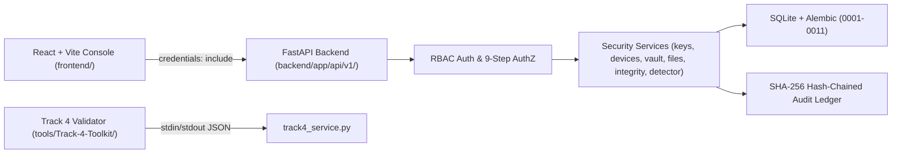

# Q-SHIELD — Quantum-Ready Trust & Revocation Control Plane

**Team:** Team Jarvis  
**Competition:** Yugaantar DevForge — Track 4 (Trust, but Verify)  

---

## 1. Project Overview

Q-SHIELD is an offline-first, CPU-first trust and revocation control plane designed to keep access decisions synchronized with real-time trust changes such as lost devices, compromised keys, and revoked accounts. It combines backend-enforced role-based access control (RBAC), salted `scrypt` password authentication, `HttpOnly` cookie sessions with 256-bit session secrets, WebAuthn / Windows Hello passkey support, AES-256-GCM envelope encryption, ML-KEM-768 adapter interoperability, a SHA-256 hash-chained audit ledger, and a deterministic, zero-ML threat detector. Q-SHIELD is a hackathon prototype and is not production-ready.

## 2. Problem Statement

In distributed and zero-trust systems, credentials or devices can be lost, stolen, or compromised while existing sessions or cached permissions remain active. Static access checks fail to enforce immediate revocation across nodes, leaving protected files and administrative controls exposed. Q-SHIELD enforces fail-closed authorization at every protected boundary and records tamper-evident audit evidence for every decision.

## 3. Key Features

- **Real User Registration & Role-Based Login:** Public `User` registration with `scrypt` password hashing; backend-verified `User`, `Employee`, and `Admin` roles.
- **Passkey / Windows Hello Authentication:** WebAuthn registration and assertion login (`webauthn==3.0.1`), challenge replay protection, and Passkey Management in Security Settings.
- **Session Management & 256-Bit Secrets:** `HttpOnly`, `SameSite=lax` cookies, 256-bit `secrets.token_bytes(32)` session secrets (SHA-256 hashed server-side), expiration, revocation, and logout invalidation.
- **9-Step Fail-Closed Vault & Crypto:** AES-256-GCM encrypted vault with AAD binding (`backend/app/vault/`) and `pqcrypto` ML-KEM-768 adapter (`track4_service.py`).
- **Crash-Safe Key Rotation & Backups:** 7-point crash-injection rotation journal recovery and HMAC-verified backup manifests.
- **Tamper-Evident Audit & Deterministic Detector:** Append-only SHA-256 hash-chained audit ledger and rule-based lateral-movement detector (zero AI/ML).
- **System File Integrity Monitoring & Data Lab:** SHA-256 baseline integrity scanning (`backend/app/integrity/`) and chunked verification lab (`backend/app/datalab/`).

## 4. Authentication and Identity Verification

- **User Registration (`POST /api/v1/auth/register`):** Validates Full Name, Email, Username, Password (min 8 chars), and Confirm Password; rejects duplicate usernames/emails (`409`); hashes passwords with `hashlib.scrypt` + random 16-byte salt; assigns `User` role automatically; and issues an authenticated session. Public registration never creates `Employee` or `Admin` accounts.
- **Password Authentication (`POST /api/v1/auth/role-login`):** Verifies username/email, `scrypt` password (`hmac.compare_digest`), account enabled state, lockout (`429` after 5 failures), and actual database role (`403` on role spoofing).
- **WebAuthn / Windows Hello (`POST /api/v1/auth/passkey-login/options`, `/verify`, `/identity-assurance/register/*`):** Supports registering platform authenticators (`navigator.credentials.create()`) and signing in with Passkey / Windows Hello (`navigator.credentials.get()`). Biometric verification is handled locally by the OS/device; Q-SHIELD stores public keys only.
- **Camera Preview vs. Facial Biometric Recognition:** Camera preview is strictly opt-in, shows a `CAMERA ACTIVE` indicator, provides `Stop Camera`, releases all `MediaStreamTrack`s on stop/logout, and never uploads frames or stores biometric templates. Facial biometric matching is **NOT IMPLEMENTED**.

| Feature | Status |
|---|---|
| Password authentication | IMPLEMENTED |
| User registration | IMPLEMENTED |
| Role-based access control | IMPLEMENTED |
| Session management | IMPLEMENTED |
| Session revocation | IMPLEMENTED |
| WebAuthn/passkey backend | IMPLEMENTED |
| Synthetic WebAuthn tests | IMPLEMENTED |
| Real Windows Hello hardware testing | NOT VERIFIED |
| Camera preview | IMPLEMENTED |
| Facial biometric matching | NOT IMPLEMENTED |

## 5. Role-Based Access Control

| Role | Dashboard Route | Backend-Enforced Permissions |
|---|---|---|
| **User** | `/dashboard/user` | View own session status, download `User` files assigned to their account, manage own passkeys. |
| **Employee** | `/dashboard/employee` | Access employee dashboard, download `Employee`/`User` operational files; denied `Admin` files and admin APIs (`403`). |
| **Admin** | `/dashboard/admin` | Provision User/Employee/Admin accounts, assign/revoke roles, enable/disable accounts, manage protected files, inspect audit logs. |

All permissions are enforced on the backend via `require_any_role` and `require_admin_role` in `backend/app/api/v1/rbac_auth_router.py`.

## 6. Security Architecture

- **Authorization:** 9-step fail-closed policy evaluation (`backend/app/policy/authz.py`) + RBAC role/ownership dependencies.
- **Cryptography:** `cryptography==50.0.2` (AES-256-GCM, HKDF, HMAC-SHA-256) and `pqcrypto==0.4.0` (ML-KEM-768).
- **Auditability:** Sequential SHA-256 hash-chained `audit_events` ledger (`backend/app/audit/service.py`).

See [docs/SECURITY_ARCHITECTURE.md](docs/SECURITY_ARCHITECTURE.md) and [docs/AUTHENTICATION.md](docs/AUTHENTICATION.md).

## 7. System Architecture



## 8. Technology Stack

- **Backend:** Python `3.12`, FastAPI `0.165.0`, SQLAlchemy `2.1.9`, Alembic `1.20.1`, SQLite, Uvicorn `0.54.0`
- **Crypto & WebAuthn:** `cryptography==50.0.2`, `pqcrypto==0.4.0`, `webauthn==3.0.1`, `cbor2==6.3.0`, `pyOpenSSL==26.4.0`
- **Frontend:** React `18.3.1`, TypeScript `5.6.3`, Vite `6.0.3`, Tailwind CSS `3.4.16`, TanStack Query `5.62.0`, Recharts `2.14.1`, Three.js `0.187.0`
- **Testing:** `pytest==9.2.0`, `httpx==0.28.1`, `vitest==2.1.8`, `playwright==1.65.2`

## 9. Repository Structure

```text
Team-Jarvis/
├── README.md
├── .gitignore
├── .env.example
├── requirements.txt
├── track4_service.py
├── threat-model.json
├── vercel.json
├── backend/
│   ├── alembic/              # Migrations 0001 through 0011
│   ├── app/                  # FastAPI routers, services, crypto, policy, audit, FIM, datalab
│   └── tests/                # Backend pytest suite
├── frontend/
│   ├── src/                  # React + TypeScript + Vite console
│   ├── package.json
│   └── package-lock.json
├── tests/adapter/            # Track 4 adapter tests
├── scripts/                  # provision_admin.py, benchmark.py, verify_auth_playwright.py
├── docs/                     # AUTHENTICATION.md, SECURITY_ARCHITECTURE.md, IMPLEMENTATION_STATUS.md
├── reports/                  # Test reports, security assessments, benchmarks, brief PDF
└── tools/Track-4-Toolkit/    # Local Track 4 toolkit (excluded from git via .gitignore)
```

## 10. Installation and Setup

```powershell
# Python 3.12 virtual environment & dependencies
py -3.12 -m venv .venv
.venv\Scripts\Activate.ps1
pip install -r requirements.txt

# Apply database migrations (0001 through 0011)
py -3.12 -m alembic -c backend/alembic.ini upgrade head

# Optional: provision an initial Admin account offline
py -3.12 scripts/provision_admin.py --actor-id admin1 --email admin1@example.com --password "YourStrongPassword#2026" --role Admin

# Install frontend dependencies (Node.js 20+/24+)
cd frontend
npm ci
cd ..
```

## 11. Running the Application

```powershell
# Terminal 1 — Backend API (http://127.0.0.1:8000)
py -3.12 -m uvicorn backend.app.main:app --host 127.0.0.1 --port 8000

# Terminal 2 — Frontend Console (http://127.0.0.1:5173)
cd frontend
npm run dev -- --host 127.0.0.1 --port 5173
```

## 12. Testing and Verification

```powershell
# Backend tests (includes RBAC, session secrets, WebAuthn, vault, audit, detector)
py -3.12 -m pytest backend/tests/ -v

# Track 4 adapter tests
py -3.12 -m pytest tests/adapter/test_track4_service.py -v

# Official Track 4 validator
cd tools/Track-4-Toolkit
py -3.12 validate.py --entry "../../track4_service.py"
cd ../..

# Frontend unit tests & production build
cd frontend
npm run test
npm run build
cd ..

# Live Playwright real-auth E2E test
py -3.12 scripts/verify_auth_playwright.py
```

## 13. Evaluation Criteria Mapping

| Criterion (Points) | Implementation | Evidence |
|---|---|---|
| Security Correctness (25) | `backend/app/policy/authz.py`, `rbac_auth_service.py`, `crypto/provider.py` | [independent_summary.md](reports/security_assessment/independent_summary.md) |
| Live / Automated Security Assessment (25) | `scripts/run_security_assessment.py`, `scripts/verify_auth_playwright.py` | [summary.md](reports/security_assessment/summary.md) |
| Functionality & Reliability (20) | `recovery/service.py`, `backups/service.py`, `alembic/` | [crash_matrix.md](reports/evidence/crash_matrix.md) |
| Threat Model & Honesty (10) | `threat-model.json`, `docs/threat_model.md`, `docs/IMPLEMENTATION_STATUS.md` | [IMPLEMENTATION_STATUS.md](docs/IMPLEMENTATION_STATUS.md) |
| Performance & Overhead (10) | `scripts/benchmark.py`, zero-ML detector | [summary.md](reports/benchmarks/summary.md) |
| Usability & Documentation (10) | `README.md`, `docs/AUTHENTICATION.md`, `reports/submission/QSHIELD_Project_Brief.pdf` | [QSHIELD_Project_Brief.pdf](reports/submission/QSHIELD_Project_Brief.pdf) |

See [docs/evaluation_mapping.md](docs/evaluation_mapping.md) for the complete mapping.

## 14. Screenshots

*(Placeholders under `docs/assets/` — add captured images before final presentation if desired.)*

- Project Banner: `docs/assets/banner.png`
- Login Page: `docs/assets/login.png`
- Registration Page: `docs/assets/register.png`
- Passkey / Windows Hello Prompt: `docs/assets/passkey_prompt.png`
- User Dashboard: `docs/assets/user_dashboard.png`
- Admin Dashboard: `docs/assets/admin_dashboard.png`
- Security Integrity Center: `docs/assets/security_integrity.png`

## 15. Security Limitations

- **Real Windows Hello Hardware:** Automated tests verify WebAuthn using synthetic P-256 fixtures; live Windows Hello hardware verification is `NOT VERIFIED` in headless CI.
- **Facial Biometric Matching:** `NOT IMPLEMENTED`. The camera preview is a non-biometric visual checkpoint only.
- **Simulated Nodes:** `sim-node-1..7` are in-process SQLite logical nodes, not physical distributed hosts.
- **Forward Secrecy & ML-DSA:** `forward_secrecy` is `NOT ESTABLISHED`; `ML-DSA` is `NOT IMPLEMENTED`.
- **Key Store:** Local filesystem `KeyMaterialStore` is a development store, not a hardware HSM.

## 16. Team Information

- **Team:** Team Jarvis
- **Competition:** Yugaantar DevForge — Track 4 (Trust, but Verify)
- **Repository:** https://github.com/ADHARV-S-RAVI/Team-Jarvis
