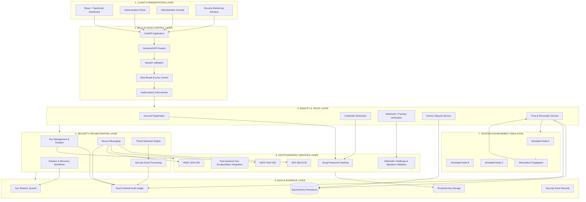

# Q-SHIELD
### Quantum-Ready Trust & Revocation Control Plane

**Team Jarvis | Yugaantar DevForge | Track 4 — Trust, but Verify**

Q-SHIELD is a security control plane designed to strengthen digital trust through identity assurance, cryptographic protection, device lifecycle management, policy enforcement, threat detection, and verifiable audit trails.

It brings multiple security capabilities into one platform, helping administrators monitor trust relationships, manage access, respond to security events, and maintain an auditable record of critical operations.

---

## Platform Preview

<p align="center">
  
" width="85%" alt="Q-SHIELD Security Dashboard">
  <br><em>Central Security Dashboard</em>
</p>

<p align="center">
  
" width="85%" alt="Q-SHIELD Authentication Interface">
  <br><em>Authentication and Identity Assurance</em>
</p>

<p align="center">
  
" width="85%" alt="Q-SHIELD Security Monitoring">
  <br><em>Security Monitoring and Trust Management</em>
</p>

---

## Core Capabilities

| Security Domain | Capabilities |
|---|---|
| Identity & Access | Account registration, role-based authentication, session management and access enforcement |
| Identity Assurance | WebAuthn/passkey authentication with cryptographic challenge verification |
| Device Lifecycle | Device registration, trust status management, revocation and lifecycle tracking |
| Cryptographic Protection | Password hashing, protected key handling and authenticated encryption |
| Key Management | Key rotation workflows, rotation journal and recovery mechanisms |
| Trust & Revocation | Centralized trust decisions and simulated node revocation |
| Threat Detection | Deterministic security event analysis and risk classification |
| Secure Messaging | Message integrity, authentication and replay protection |
| Audit & Compliance | Hash-chained audit records and verifiable event history |
| Security Dashboard | Centralized visibility into platform activity and security status |

---

## System Architecture

Q-SHIELD follows a layered architecture that separates user interaction, identity enforcement, security orchestration, cryptographic operations, persistence, and auditability.

This separation helps keep security-sensitive operations within dedicated backend services instead of relying on frontend controls.



### Architectural Layers

**1. Client & Presentation Layer**

Provides the interactive security dashboard, authentication portal, administrative console, and monitoring views. The frontend communicates with backend APIs and presents security state to authorized users.

**2. API & Access Control Layer**

Acts as the controlled entry point for platform operations. It handles request routing, session validation, role verification, and backend authorization.

**3. Identity & Trust Layer**

Manages account registration, authentication, passkey verification, device lifecycle operations, and trust decisions. Identity and authorization checks are enforced by the backend.

**4. Security Orchestration Layer**

Coordinates key rotation, secure messaging, security event processing, threat detection, and recovery workflows. It connects individual security services into complete operational processes.

**5. Cryptographic Services Layer**

Provides the cryptographic primitives and verification mechanisms used by the platform, including password hashing, authenticated encryption, key derivation, message authentication, and WebAuthn verification.

**6. Data & Evidence Layer**

Maintains application records, protected key material, rotation history, security events, and hash-chained audit records. It provides the persistence and evidence foundation for security operations.

**7. Trusted Environment Simulation**

Represents distributed nodes participating in trust and revocation workflows. It allows the prototype to demonstrate trust-state changes and revocation behavior in a controlled environment.

### Important Security Boundaries

- The frontend is not treated as a trusted authorization authority.
- Authentication and role enforcement take place on the backend.
- Session secrets are not stored as plaintext in the session database.
- Passkey assertions are verified by the backend.
- Security-sensitive operations generate auditable records.
- Device and node trust states are managed through backend services.

---

## Authentication & Identity Assurance

Q-SHIELD combines conventional account authentication with modern cryptographic identity assurance.

- Passwords are protected using salted Scrypt hashing.
- Role-based access is enforced by backend authorization checks.
- Sessions use random secrets, HTTP-only cookies, and server-side revocation.
- WebAuthn supports passkey-based cryptographic authentication.
- Supported platform authenticators, including Windows Hello, can provide local user verification.

**Privacy-conscious camera handling:** The camera preview is a separate consent-based interface. It does not perform facial recognition or establish identity. Passkey verification is the identity-assurance mechanism.

---

## Cryptographic Foundation

| Component | Purpose |
|---|---|
| ML-KEM-768 | Post-quantum key encapsulation capability |
| AES-256-GCM | Authenticated encryption |
| HKDF-SHA-256 | Cryptographic key derivation |
| HMAC-SHA-256 | Message authentication and integrity |
| Scrypt | Password hashing |
| WebAuthn | Public-key-based authentication |
| Hash-Chained Ledger | Tamper-evident audit history |

Cryptographic components are used for distinct security responsibilities rather than treating a single algorithm as a complete security solution.

---

## Technology Stack

| Layer | Technologies |
|---|---|
| Frontend | React, TypeScript, Vite, Tailwind CSS |
| Backend | Python 3.12, FastAPI, Pydantic |
| Database | SQLAlchemy, SQLite |
| Migrations | Alembic |
| Authentication | Scrypt, WebAuthn |
| Cryptography | AES-GCM, HKDF, HMAC and ML-KEM integration |
| Testing | Pytest, HTTPX, Vitest, Playwright |
| Performance | psutil and benchmark utilities |

---

## Repository Structure

```text
Team-Jarvis/
│
├── backend/
│   ├── app/
│   │   ├── api/
│   │   ├── core/
│   │   ├── models/
│   │   ├── services/
│   │   └── main.py
│   ├── migrations/
│   └── tests/
│
├── frontend/
│   ├── src/
│   │   ├── components/
│   │   ├── pages/
│   │   ├── services/
│   │   └── hooks/
│   └── package.json
│
├── scripts/
├── docs/
│   └── assets/
│
├── tools/
│   └── Track-4-Toolkit/
│
├── track4_service.py
├── requirements.txt
└── README.md
```

*The final repository tree should reflect the actual committed files.*

---

## Getting Started

### Prerequisites

- Python 3.12
- Node.js 22 or compatible version
- npm

### Backend Setup

```bash
py -3.12 -m venv .venv
```

Activate the environment and install dependencies:

```bash
pip install -r requirements.txt
```

Apply database migrations:

```bash
py -3.12 -m alembic -c backend/alembic.ini upgrade head
```

Start the backend:

```bash
python -m uvicorn backend.app.main:app --host 127.0.0.1 --port 8000
```

### Frontend Setup

```bash
cd frontend
npm ci
npm run dev
```

### Application Access

| Service | Address |
|---|---|
| Frontend | `http://localhost:5173` |
| Backend API | `http://127.0.0.1:8000` |
| API Documentation | `http://127.0.0.1:8000/docs` |

---

## Testing & Validation

Q-SHIELD includes backend tests, adapter tests, frontend tests, browser-based authentication checks, and official Track 4 toolkit validation.

| Validation Area | Reported Result |
|---|---:|
| Backend Tests | 54 passed |
| Adapter Tests | 9 passed |
| Frontend Tests | 7 passed |
| Official Toolkit Validator | 21/21 checks |
| Frontend Production Build | Passed |
| Real Authentication Browser E2E | Passed |

These results reflect the latest reported development test run. Final evaluation should be performed against the exact submitted commit and environment.

---

## Track 4 Evaluation Alignment

| Evaluation Area | Q-SHIELD Implementation |
|---|---|
| Security Correctness | Authentication, RBAC, session controls, cryptographic services and revocation workflows |
| Security Assessment | Automated tests, adapter validation and security-focused browser checks |
| Functionality & Reliability | Integrated dashboard, backend services, persistence and lifecycle workflows |
| Threat Model & Documentation | Layered architecture, trust boundaries, security responsibilities and implementation scope |
| Performance & Overhead | Benchmarking utilities and performance measurements |
| Usability & Documentation | Administrative dashboard, authentication interface, setup instructions and visual evidence |

---

## Implementation Scope & Future Evolution

Q-SHIELD is an actively developed security prototype. Its architecture establishes a foundation for further deployment-oriented hardening and broader security integration.

The current implementation provides a controlled environment for demonstrating identity assurance, access enforcement, cryptographic workflows, device trust, revocation, threat detection, and auditability.

Further engineering can extend the platform through:

- Production-grade hardware-backed key management and HSM integration.
- Expanded post-quantum cryptographic coverage and migration workflows, including ML-DSA.
- Formal forward-secrecy analysis and protocol validation.
- Broader threat-detection datasets and evaluation against additional attack scenarios.
- Real distributed infrastructure integration beyond simulated nodes.
- Expanded biometric and identity-assurance research, with explicit consent and privacy safeguards.
- Additional deployment, monitoring, and operational security controls.

These areas represent the platform's next engineering milestones, rather than claims of capabilities that are not yet implemented.

---

## Project Information

**Project:** Q-SHIELD  
**Team:** Team Jarvis  
**Event:** Yugaantar DevForge  
**Track:** Track 4 — Trust, but Verify  

**Repository:** https://github.com/ADHARV-S-RAVI/Team-Jarvis
**YouTube Demo Video:** https://youtu.be/81R2i4c5XyA?si=y5VgEUDAjn9mEiV0
**Deployed Link:** https://team-jarvis-ten.vercel.app/

---

*Q-SHIELD — Building verifiable trust through identity, cryptography, and security intelligence.*
