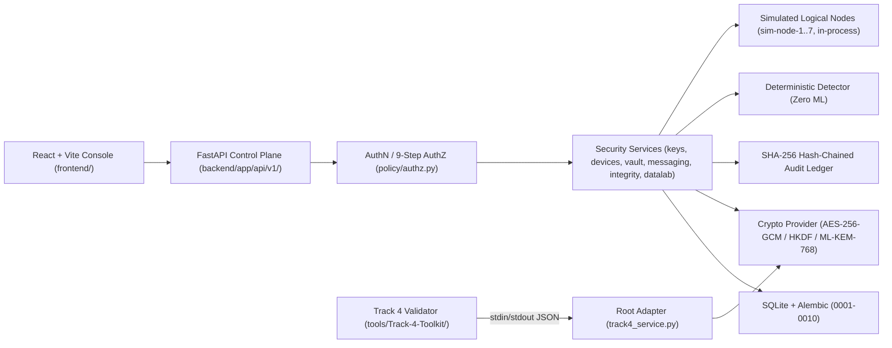

# Q-SHIELD — Quantum-Ready Trust & Revocation Control Plane

**Team:** Team Jarvis  
**Competition:** Yugaantar DevForge  
**Track:** Track 4 — Trust, but Verify  

---

## 1. Project Overview

Q-SHIELD addresses the gap between trust-state changes (lost devices, compromised keys, revoked actors) and enforcement across protected resources and nodes. It protects encrypted vault payloads, authenticated messages, and application integrity baselines using a 9-step fail-closed authorization pipeline, salted `scrypt` password authentication, AES-256-GCM envelope encryption, and ML-KEM-768 adapter interoperability. When a device or key is revoked, Q-SHIELD persists monotonic revocation tombstones, propagates state across simulated nodes, supports crash-safe journaled key rotation recovery, and records every decision in a SHA-256 hash-chained audit ledger paired with a deterministic, zero-ML lateral-movement detector. Q-SHIELD is an offline-first hackathon prototype and is not production-ready.

---

## 2. Key Capabilities

- **Identity and Access Control:** 9-step fail-closed policy evaluation (`backend/app/policy/authz.py`), salted `scrypt` password authentication with rate limiting (`backend/app/services/foundation_service.py`), and WebAuthn/FIDO2 identity assurance (`docs/IDENTITY_ASSURANCE.md`).
- **Cryptography and Protected Resources:** AES-256-GCM AEAD vault with AAD binding (`backend/app/vault/service.py`), `pqcrypto` ML-KEM-768 adapter (`track4_service.py`), and HMAC-SHA-256 proofs (`docs/crypto_design.md`).
- **Device Lifecycle and Revocation:** Device enrolment, suspension, terminal revocation, replacement enrolment, and lost-device containment receipts (`docs/DEVICE_SESSION_LIFECYCLE.md`).
- **Key Management and Recovery:** 4-phase key rotation with zero-grace cutoff, 7-point crash-safe rotation journal recovery, and HMAC-verified backup manifests (`docs/CRASH_RECOVERY_BACKUPS.md`).
- **Audit and Threat Detection:** Append-only SHA-256 hash-chained audit ledger (`docs/AUDIT_LEDGER_AND_RECEIPTS.md`) and deterministic rule-based lateral-movement detector (`docs/DETECTION_AND_LATERAL_MOVEMENT.md`).
- **Secure Messaging:** AAD-bound AEAD messaging, durable replay ledger, loss/reordering recovery, and peer-bound session resumption (`docs/SECURE_MESSAGING.md`).
- **File Integrity and Data Lab:** SHA-256 System File Integrity Monitoring (`docs/FILE_INTEGRITY_MONITORING.md`) and resumable chunked Data Verification Lab (`backend/app/datalab/`).
- **Performance Measurement:** `perf_counter_ns` benchmark suite with `psutil` CPU/RAM telemetry (`docs/benchmark_methodology.md`).

---

## 3. Architecture



**Simulated vs. Real Components:** `sim-node-1..7` are local SQLite-backed logical nodes simulating propagation delay and partitions in-process. Authorization, AEAD encryption, salted `scrypt` hashing, audit hash-chaining, FIM hashing, and `track4_service.py` execute real operations.

---

## 4. Repository Structure

```text
Team-Jarvis/
├── README.md
├── .gitignore
├── .env.example
├── requirements.txt              # Pinned Python 3.12 dependencies
├── track4_service.py             # Official Track 4 root adapter
├── threat-model.json             # Adapter threat-model metadata
├── backend/
│   ├── alembic/                  # Migrations 0001 through 0010
│   ├── app/                      # FastAPI services, crypto, policy, audit, detector, FIM, datalab
│   └── tests/                    # Backend pytest suite (53 tests)
├── frontend/
│   ├── src/                      # React + TypeScript + Vite operator console
│   ├── package.json              # Node dependencies and scripts
│   └── package-lock.json
├── tests/adapter/                # Track 4 adapter black-box tests (9 tests)
├── scripts/                      # Benchmark, Playwright E2E, and security assessment scripts
├── docs/                         # Architecture, threat model, compliance, evaluation mapping
├── reports/                      # Test reports, security assessments, benchmarks, brief PDF
└── tools/Track-4-Toolkit/        # Local Track 4 toolkit (gitignored from submission)
```

---

## 5. Technology Stack

- **Backend:** Python `3.12`, FastAPI `0.165.0`, SQLAlchemy `2.1.9`, Alembic `1.20.1`, SQLite, Uvicorn `0.54.0`, Pydantic `2.14.4`
- **Cryptography & Identity:** `cryptography==50.0.2` (AES-256-GCM, HKDF, HMAC-SHA-256), `pqcrypto==0.4.0` (ML-KEM-768), `webauthn==3.0.1`, `cbor2==6.3.0`, `pyOpenSSL==26.4.0`
- **Frontend:** React `18.3.1`, TypeScript `5.6.3`, Vite `6.0.3`, Tailwind CSS `3.4.16`, TanStack Query `5.62.0`, Recharts `2.14.1`, Three.js `0.187.0`
- **Testing & Telemetry:** `pytest==9.2.0`, `httpx==0.28.1`, `vitest==2.1.8`, `playwright==1.65.2`, `psutil==7.2.2`

---

## 6. Installation

```powershell
# 1. Create and activate Python 3.12 virtual environment
py -3.12 -m venv .venv
.venv\Scripts\Activate.ps1

# 2. Install pinned Python dependencies
pip install -r requirements.txt

# 3. Apply database migrations (creates local SQLite DB)
py -3.12 -m alembic -c backend/alembic.ini upgrade head

# 4. Install frontend dependencies
cd frontend
npm ci
cd ..
```

*(On Linux/macOS, replace `py -3.12` with `python3.12` and `.venv\Scripts\Activate.ps1` with `source .venv/bin/activate`.)*

---

## 7. Running the Application

```powershell
# Terminal 1 — Backend API (http://127.0.0.1:8000, docs at /docs)
py -3.12 -m uvicorn backend.app.main:app --host 127.0.0.1 --port 8000

# Terminal 2 — Frontend Console (http://127.0.0.1:5173)
cd frontend
npm run dev -- --host 127.0.0.1 --port 5173
```

---

## 8. Running Tests

```powershell
# Backend tests (53 tests)
py -3.12 -m pytest backend/tests/ -v

# Track 4 adapter tests (9 tests)
py -3.12 -m pytest tests/adapter/test_track4_service.py -v

# Official Track 4 validator (run from toolkit directory)
cd tools/Track-4-Toolkit
py -3.12 validate.py --entry "../../track4_service.py"
cd ../..

# Frontend unit tests and production build
cd frontend
npm run test
npm run build
cd ..

# Automated security assessment & independent verification
py -3.12 scripts/run_security_assessment.py
py -3.12 scripts/run_independent_verification.py

# Deterministic perf_counter_ns benchmarks
py -3.12 scripts/benchmark.py
```

---

## 9. Hackathon Evaluation Mapping

| Criterion (Points) | Implementation | Evidence | Verification Command |
|---|---|---|---|
| **Security Correctness (25)** | `backend/app/policy/authz.py`, `crypto/provider.py`, `foundation_service.py` | [independent_summary.md](reports/security_assessment/independent_summary.md) | `py -3.12 -m pytest backend/tests/ -v` |
| **Live / Automated Security Assessment (25)** | `scripts/run_security_assessment.py`, `scripts/run_independent_verification.py` | [summary.md](reports/security_assessment/summary.md) | `py -3.12 scripts/run_security_assessment.py` |
| **Functionality & Reliability (20)** | `recovery/service.py`, `backups/service.py`, `datalab/`, `alembic/` | [crash_matrix.md](reports/evidence/crash_matrix.md) | `py -3.12 -m alembic -c backend/alembic.ini upgrade head` |
| **Threat Model & Honesty (10)** | `threat-model.json`, `ScorecardPage.tsx`, `REAL_IMPLEMENTATION_AUDIT.md` | [threat_model.md](docs/threat_model.md) | `py -3.12 tools/Track-4-Toolkit/validate.py --entry "../../track4_service.py"` |
| **Performance & Overhead (10)** | `scripts/benchmark.py`, deterministic detector (`0` ML imports) | [summary.md](reports/benchmarks/summary.md) | `py -3.12 scripts/benchmark.py` |
| **Usability & Documentation (10)** | `README.md`, `frontend/src/`, `demo_script.md`, Project Brief PDF | [QSHIELD_Project_Brief.pdf](reports/submission/QSHIELD_Project_Brief.pdf) | `cd frontend && npm run test && npm run build` |

Full details: [docs/evaluation_mapping.md](docs/evaluation_mapping.md).

---

## 10. Security Design

- **Authentication:** Salted `scrypt` password hashing (`hmac.compare_digest`), login rate limiting (`5` failures / `60s`), and session revocation on password change (`backend/app/services/foundation_service.py`).
- **Authorization:** 9-step fail-closed policy evaluation checking actor status, session binding, device trust, role permissions, resource status, and revocation tombstones (`backend/app/policy/authz.py`).
- **Encryption & Key Management:** AES-256-GCM envelope encryption with AAD binding, `pqcrypto` ML-KEM-768 adapter encapsulation, 4-phase key rotation, and 7-point crash recovery (`docs/crypto_design.md`, `docs/CRASH_RECOVERY_BACKUPS.md`).
- **Audit & Detection:** SHA-256 hash-chained audit ledger (`docs/AUDIT_LEDGER_AND_RECEIPTS.md`) and deterministic rule-based lateral-movement detector (`docs/DETECTION_AND_LATERAL_MOVEMENT.md`).

---

## 11. Evidence

- [Test Report Summary](reports/test_report/summary.md)
- [Automated Security Assessment](reports/security_assessment/summary.md) & [Independent Security Verification](docs/INDEPENDENT_SECURITY_VERIFICATION.md)
- [Benchmark Summary](reports/benchmarks/summary.md) & [Methodology](docs/benchmark_methodology.md)
- [Threat Model](docs/threat_model.md) & [Toolkit Compliance](docs/TOOLKIT_COMPLIANCE.md)
- [Two-Page Project Brief PDF](reports/submission/QSHIELD_Project_Brief.pdf)
- [Five-Minute Demo Script](docs/demo_script.md)

---

## 12. Honest Limitations

- **Simulated Logical Nodes:** `sim-node-1..7` run in-process on SQLite rather than across physical distributed hosts.
- **Local SQLite & Dev Key Store:** Single-host SQLite WAL database and filesystem `KeyMaterialStore` (not a hardware HSM).
- **Forward Secrecy:** `NOT ESTABLISHED` (no per-message ephemeral DH/KEM ratchet).
- **ML-DSA Signatures:** `NOT IMPLEMENTED` (integrity uses HMAC-SHA-256 and SHA-256 chains).
- **WebAuthn & Camera Demo:** Automated WebAuthn tests use synthetic P-256 fixtures; the camera preview is non-authenticating and never uploads frames or stores biometric templates.
- **File Integrity Monitoring:** Browser-selected file hashing covers user-chosen files only, not OS-wide antivirus scanning.
- **Detector Evaluation:** Metrics are measured on the synthetic practice dataset only.

See [docs/limitations.md](docs/limitations.md) for full details.

---

## 13. License

No `LICENSE` file is currently present in the repository.
