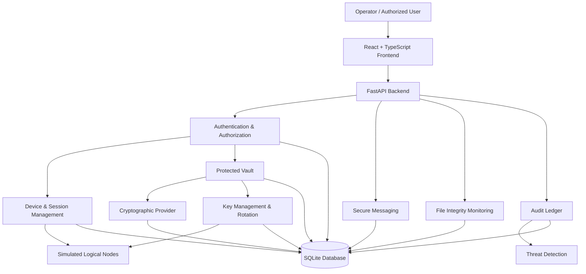
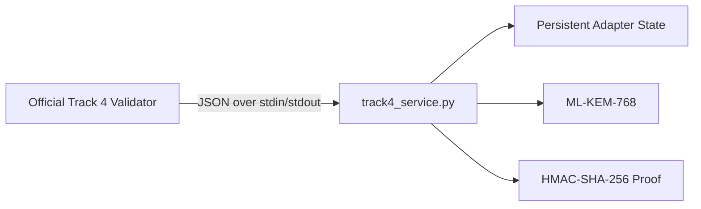

# Q-SHIELD
### Quantum-Ready Trust & Revocation Control Plane

**Team:** Team Jarvis  
**Competition:** Yugaantar DevForge  
**Track:** Track 4 — Trust, but Verify

<!-- PROJECT BANNER PLACEHOLDER -->
<!-- Add your Q-SHIELD project banner at docs/assets/qshield-banner.png -->
<p align="center">
  
</p>

---

## 1. Overview

Q-SHIELD is a security control plane designed to manage digital identity, access authorization, cryptographic protection and revocation across protected resources.

It addresses a critical security problem: when an identity, device or cryptographic key becomes compromised, access must be revoked consistently, and the resulting security decisions must be verifiable.

The system combines fail-closed authorization, encrypted resource storage, post-quantum key encapsulation interoperability, device lifecycle management, distributed revocation simulation, crash-safe key rotation, tamper-evident auditing and deterministic threat detection.

Q-SHIELD also provides secure messaging, file integrity monitoring and a web-based operator interface.

The project is an offline-first hackathon prototype. Its simulated infrastructure and deployment limitations are documented explicitly.

## 2. Key Features

| Security Area | Implementation |
|---|---|
| Identity & Authentication | Salted Scrypt password hashing, session validation, rate limiting and WebAuthn/passkey support |
| Access Control | Nine-step, fail-closed authorization pipeline with role and resource ownership checks |
| Cryptographic Protection | AES-256-GCM authenticated encryption, HKDF-SHA-256 and HMAC-SHA-256 |
| Post-Quantum Cryptography | ML-KEM-768 integration through the official Track 4 adapter |
| Device Security | Device enrolment, suspension, revocation, replacement and lost-device containment |
| Distributed Revocation | Persistent revocation tombstones, logical node propagation and acknowledgement tracking |
| Key Management | Versioned keys, four-phase rotation, crash recovery and backup integrity verification |
| Audit | Append-only SHA-256 hash-chained audit ledger |
| Threat Detection | Deterministic rule-based detection with explainable alerts and no AI/ML dependencies |
| Secure Messaging | Authenticated encryption, recipient binding, replay protection and session resumption |
| File Integrity | SHA-256 application file monitoring and explicitly selected user-file verification |
| Performance | Repeatable benchmarks for cryptographic operations, authorization, messaging and system overhead |

All capabilities should be interpreted according to their documented implementation status and limitations.

## 3. Application Preview

<!-- DASHBOARD SCREENSHOT PLACEHOLDER -->
<!-- Add the actual desktop dashboard screenshot at docs/assets/dashboard-overview.png -->


*Q-SHIELD operator dashboard — replace this placeholder with an actual application screenshot.*


*Security Integrity Center — identity assurance and file integrity monitoring.*


## 4. System Architecture

Q-SHIELD follows a modular architecture with a React frontend, FastAPI backend, persistent database, cryptographic services and security monitoring components.



### Track 4 Adapter Architecture

The official Track 4 adapter operates separately from the web application.



### Infrastructure Classification

The following distinctions are important:

- **Real operations:** Authentication, authorization, AES-GCM encryption, hashing, HMAC verification, audit-chain computation and file hashing execute actual operations.
- **Sandbox simulation:** Logical nodes simulate distributed revocation propagation, acknowledgement and connectivity conditions within the local environment.
- **Development infrastructure:** SQLite and the local filesystem-based key store are used instead of a distributed database or hardware security module.

Detailed architecture: [System Architecture](docs/architecture.md)

## 5. Repository Structure

```text
Team-Jarvis/
│
├── README.md
├── .gitignore
├── .env.example
├── requirements.txt
├── track4_service.py
├── threat-model.json
│
├── backend/
│   ├── app/
│   │   ├── api/
│   │   ├── audit/
│   │   ├── backups/
│   │   ├── crypto/
│   │   ├── detector/
│   │   ├── devices/
│   │   ├── identity_assurance/
│   │   ├── integrity/
│   │   ├── keys/
│   │   ├── messaging/
│   │   ├── nodes/
│   │   ├── policy/
│   │   ├── recovery/
│   │   └── vault/
│   ├── alembic/
│   └── tests/
│
├── frontend/
│   ├── src/
│   ├── public/
│   ├── package.json
│   └── package-lock.json
│
├── tests/
│   └── adapter/
│
├── scripts/
│   ├── benchmark.py
│   ├── run_security_assessment.py
│   └── verify_frontend_playwright.py
│
├── docs/
│   ├── architecture.md
│   ├── security_design.md
│   ├── threat_model.md
│   ├── api_reference.md
│   ├── evaluation_mapping.md
│   ├── requirement_traceability.csv
│   ├── benchmark_methodology.md
│   ├── limitations.md
│   └── demo_script.md
│
├── reports/
│   ├── test_report/
│   ├── security_assessment/
│   ├── benchmarks/
│   ├── detector/
│   ├── evidence/
│   └── submission/
│
└── tools/
    └── Track-4-Toolkit/
```

*The structure above highlights the main project components. Refer to the actual repository for the complete directory tree.*

## 6. Technology Stack

### Backend

- Python 3.12
- FastAPI
- SQLAlchemy
- Alembic
- SQLite
- Pydantic
- Uvicorn

### Cryptography and Identity

- `cryptography` — AES-256-GCM, HKDF and HMAC-SHA-256
- `pqcrypto` — ML-KEM-768
- `webauthn` — WebAuthn authentication
- `cbor2` — CBOR support

### Frontend

- React 18
- TypeScript
- Vite
- Tailwind CSS
- TanStack Query
- Recharts

### Testing and Performance

- pytest
- HTTPX
- Vitest
- Playwright
- psutil
- Python `perf_counter_ns`

Exact dependency versions are maintained in the project dependency files.

## 7. Installation and Setup

### Prerequisites

- Python 3.12
- Node.js and npm
- Git

### Step 1: Clone the repository

```bash
git clone https://github.com/ADHARV-S-RAVI/Team-Jarvis.git
cd Team-Jarvis
```

### Step 2: Create a Python virtual environment

**Windows PowerShell**

```powershell
py -3.12 -m venv .venv
.venv\Scripts\Activate.ps1
```

**Linux / macOS**

```bash
python3.12 -m venv .venv
source .venv/bin/activate
```

### Step 3: Install backend dependencies

```bash
python -m pip install -r requirements.txt
```

### Step 4: Configure environment variables

Use `.env.example` as the configuration reference.

Create a local `.env` file if required by the application.

Never commit actual secrets, private keys or local master keys.

### Step 5: Apply database migrations

```bash
python -m alembic -c backend/alembic.ini upgrade head
```

### Step 6: Install frontend dependencies

```bash
cd frontend
npm ci
cd ..
```

## 8. Running Q-SHIELD

Start the backend and frontend in separate terminals.

### Backend

From the repository root:

```bash
python -m uvicorn backend.app.main:app --host 127.0.0.1 --port 8000
```

Backend API:

`http://127.0.0.1:8000`

Interactive API documentation:

`http://127.0.0.1:8000/docs`

### Frontend

From the repository root:

```bash
cd frontend
npm run dev -- --host 127.0.0.1 --port 5173
```

Frontend application:

`http://127.0.0.1:5173`

## 9. Testing and Verification

Q-SHIELD includes backend tests, adapter tests, frontend tests, browser verification and security assessment scripts.

Run the commands from the repository root unless otherwise specified.

### Backend Tests

```bash
python -m pytest backend/tests/ -v
```

### Track 4 Adapter Tests

```bash
python -m pytest tests/adapter/test_track4_service.py -v
```

### Official Track 4 Validator

From the toolkit directory:

```bash
cd tools/Track-4-Toolkit
python validate.py --entry "../../track4_service.py"
cd ../..
```

### Frontend Tests

```bash
cd frontend
npm run test
npm run build
cd ..
```

### Security Assessment

```bash
python scripts/run_security_assessment.py
```

Run independent verification if the corresponding script is included in the repository:

```bash
python scripts/run_independent_verification.py
```

### Browser Verification

```bash
python scripts/verify_frontend_playwright.py
```

### Performance Benchmarks

```bash
python scripts/benchmark.py
```

Test results and benchmark outputs are stored under `reports/`.

## 10. Hackathon Evaluation Mapping

The following table maps Q-SHIELD to the six evaluation criteria.

| Evaluation Criterion | Points | Relevant Implementation | Verification |
|---|---:|---|---|
| Security Correctness | 25 | Authentication, authorization, cryptographic provider, protected vault and key management | Backend security tests and adapter tests |
| Live / Automated Security Assessment | 25 | Revocation enforcement, replay protection, integrity detection, audit verification and deterministic threat detection | Security assessment scripts and test evidence |
| Functionality & Reliability | 20 | Normal operations, security controls, crash recovery, backup verification and persistent state | Backend tests, migration tests and recovery evidence |
| Threat Model & Honesty | 10 | Threat model, security boundaries, trust assumptions and documented limitations | Threat model and implementation documentation |
| Performance & Overhead | 10 | Cryptographic, authorization, messaging, audit and integrity benchmarks | Benchmark scripts and raw measurements |
| Usability & Documentation | 10 | Operator interface, setup instructions, API documentation and reproducible tests | Frontend tests, production build and README |

Detailed mapping:

[Hackathon Evaluation Mapping](docs/evaluation_mapping.md)

## 11. Security Design

### Authentication and Authorization

Q-SHIELD uses salted Scrypt password hashing, server-side session validation and a nine-step fail-closed authorization pipeline.

WebAuthn provides cryptographic credential-based authentication. Local authenticators such as Windows Hello may perform biometric or PIN verification without exposing biometric data to the website.

### Cryptographic Protection

Protected resources use AES-256-GCM authenticated encryption with associated authenticated data.

HKDF-SHA-256 provides purpose-separated key derivation. HMAC-SHA-256 is used for authenticated proofs and manifest integrity.

The Track 4 adapter implements ML-KEM-768 interoperability.

### Revocation and Key Management

Revocation tombstones persist security-state changes. Logical nodes process propagation and acknowledge revocation state.

Key rotation uses a four-phase workflow with durable recovery journals and backup verification.

### Audit and Threat Detection

Security events are recorded in a SHA-256 hash-chained audit ledger.

A deterministic rule-based detector processes telemetry and generates explainable alerts without AI/ML dependencies.

Further documentation:

- [Security Design](docs/security_design.md)
- [Threat Model](docs/threat_model.md)
- [API Reference](docs/api_reference.md)
- [Toolkit Compliance](docs/TOOLKIT_COMPLIANCE.md)

## 12. Evidence and Reports

The repository includes evidence supporting implementation and verification.

| Evidence | Location |
|---|---|
| Backend and adapter test reports | `reports/test_report/` |
| Security assessment | `reports/security_assessment/` |
| Performance benchmarks | `reports/benchmarks/` |
| Detector evaluation | `reports/detector/` |
| Crash recovery evidence | `reports/evidence/` |
| Project brief | `reports/submission/QSHIELD_Project_Brief.pdf` |

Additional references:

- [Acceptance Gates](docs/acceptance_gates.md)
- [Requirement Traceability](docs/requirement_traceability.csv)
- [Five-Minute Demo Script](docs/demo_script.md)
- [Implementation Status](docs/implementation_status.md)

## 13. Limitations and Security Disclosures

Q-SHIELD is a hackathon prototype. The following limitations are explicit:

1. **Simulated Nodes:** Logical nodes are SQLite-backed simulations, not physically distributed servers.
2. **Database:** SQLite is used for local persistence; distributed database deployment is not implemented.
3. **Key Storage:** The development key store uses local filesystem storage and is not an HSM.
4. **Forward Secrecy:** NOT ESTABLISHED. The messaging implementation does not provide a per-message ephemeral ratchet.
5. **ML-DSA:** NOT IMPLEMENTED.
6. **WebAuthn Hardware Testing:** Automated tests use synthetic cryptographic fixtures. Live Windows Hello hardware verification has not been established by those tests.
7. **Camera Demo:** The camera preview is non-authenticating. It does not establish identity.
8. **File Integrity Scope:** Browser-based scanning only covers explicitly selected files. It does not provide silent OS-wide scanning or antivirus functionality.
9. **Threat Detection:** Reported practice-dataset metrics demonstrate functional behavior on that dataset and must not be interpreted as production detection accuracy.

See [Limitations](docs/limitations.md) for further details.

## 14. License

A license has not yet been specified in this repository.

No license permissions should be assumed until an appropriate `LICENSE` file is added.

---

## Project Information

**Project:** Q-SHIELD — Quantum-Ready Trust & Revocation Control Plane  
**Team:** Team Jarvis  
**Competition:** Yugaantar DevForge  
**Track:** Track 4 — Trust, but Verify  
**Repository:** https://github.com/ADHARV-S-RAVI/Team-Jarvis

**Official Track 4 Toolkit:**  
https://github.com/ScalerOpenSourceLabs/Track-4-Toolkit
